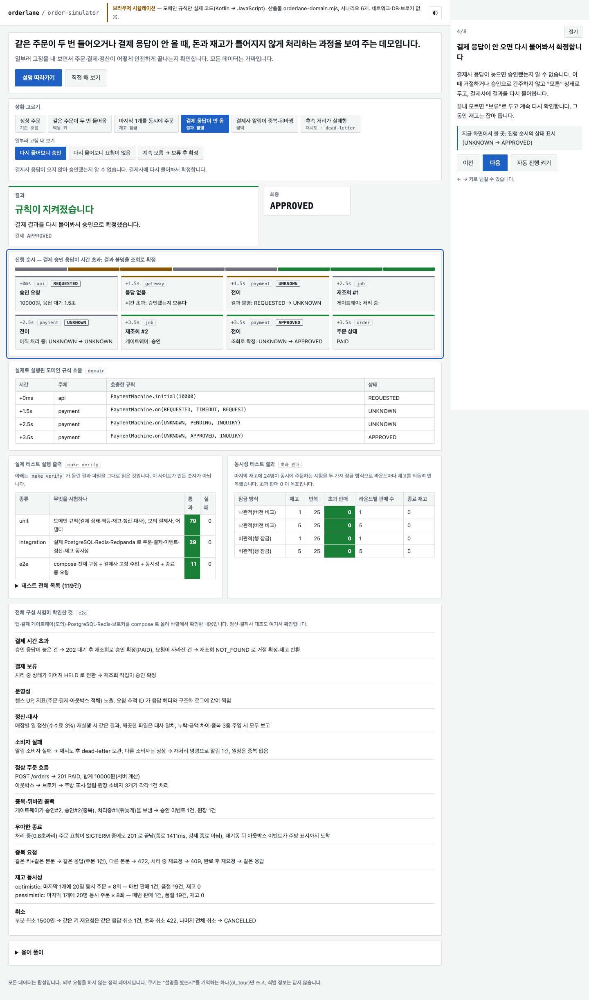
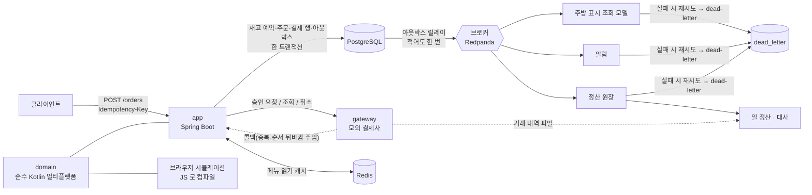

# Orderlane

**데모: https://choibongseok.github.io/orderlane/**

매장 주문 → 결제 → 정산을 다루는 작은 백엔드입니다. Kotlin · Spring Boot 3 · PostgreSQL · Redis · Kafka 호환 브로커(Redpanda).
화면이 아니라 **돈과 재고가 걸린 요청을 중복·동시·실패 상황에서 맞게 처리하는 법**이 주제입니다. 데이터는 모두 합성이고, 결제사는 저장소 안의 모의 게이트웨이입니다.



데모 사이트는 운영 대시보드 형태입니다. "설명 따라가기"를 누르면 8장짜리 안내가 같은 주문 두 번, 마지막 1개 동시 주문, 결제 응답 없음, 알림 중복·뒤바뀜, 후속 처리 실패, 정산 순서로 시나리오를 대신 골라 주고, 직접 고장을 내 보면서 상태 전이를 타임라인으로 볼 수도 있습니다.
이 타임라인은 서버가 쓰는 **같은 Kotlin 도메인 모듈을 JavaScript 로 컴파일해** 브라우저에서 돌린 결과입니다(규칙을 JS 로 다시 쓰지 않았습니다). 네트워크·DB·브로커는 없는 시뮬레이션이고, 실제 서버 동작은 테스트로 확인합니다.

## 구조



| 모듈 | 내용 |
|---|---|
| `domain` | 프레임워크 의존 없는 순수 Kotlin(JVM + JS). 금액, 결제 상태 기계, 멱등 판정, 재고 규칙, 소비(중복 제거·재시도) 정책, 정산·대사, 시뮬레이션 |
| `app` | Spring Boot. 주문·결제·아웃박스·소비자·정산·캐시·운영성. 도메인 규칙은 모두 `domain` 을 호출 |
| `gateway` | 모의 결제 게이트웨이(JDK HTTP 서버). 카드 토큰으로 지연·시간 초과·중복·뒤바뀐 콜백·보류·거래 내역 파일 이상을 주입 |
| `e2e` | compose 전체 구성을 바깥에서 두드리는 시험 |
| `web` | 정적 데모 사이트(외부 요청 없음)와 Playwright 시험 |

## 5분 실행

필요한 것: Docker, JDK 17~24 중 아무거나(Gradle 실행용). 빌드는 Gradle 툴체인이 JDK 21 을 첫 실행 때 내려받아 씁니다(네트워크 필요). 로컬에 Gradle 은 필요 없고 저장소의 래퍼(8.14.3)를 씁니다. 의존성 버전은 `gradle/libs.versions.toml` 에 고정되어 있습니다.

```bash
make up        # jar 빌드 → 이미지 → compose 기동. 앱 http://127.0.0.1:58680
curl -s -XPOST localhost:58680/orders -H 'Authorization: Bearer demo-token' -H 'Idempotency-Key: demo-1' \
  -H 'Content-Type: application/json' -d '{"storeId":1,"lines":[{"menuItemId":1,"quantity":2,"optionId":101}]}'
# 같은 명령을 다시 실행하면 같은 응답(주문은 1건). 결제 실패는 paymentToken 으로 주입:
#   tok_decline, tok_timeout_approved, tok_timeout_lost, tok_timeout_callbacks, tok_hold, tok_slow_<ms>
make replay-dlq   # dead-letter 재처리 명령
make down
```

호스트 포트는 586xx 대역(앱 58680, 게이트웨이 58690, PostgreSQL 58632, Redis 58679)을 씁니다.
`make up` 의 구성은 시연용이라 실패 주입(`orderlane.faults.enabled`)이 켜져 있고 결제 시간 제한이 짧습니다(1초). 운영 기본값은 `app/src/main/resources/application.yml` 입니다.

## 설계 결정

### 1. 멱등 키 저장과 처리 중 재요청
`POST /orders` 와 `POST /orders/{id}/cancellations` 는 `Idempotency-Key` 헤더가 필수입니다. 키는 `idempotency_key(scope, key)` 에 `INSERT … ON CONFLICT DO NOTHING` 으로 선점하고, 판정은 도메인의 `Idempotency.decide` 가 합니다.

| 같은 키로 다시 오면 | 응답 |
|---|---|
| 같은 본문 + 완료됨 | 처음 응답을 그대로(상태 코드 포함, 품절 409 도 그대로) |
| 다른 본문 | 422 `IDEMPOTENCY_KEY_REUSED` |
| 같은 본문 + 처리 중 | 409 `IDEMPOTENCY_IN_PROGRESS` |
| 처리 중이지만 잠금(기본 30초)이 지남 | 처리하던 쪽이 죽은 것으로 보고 이어받음 |

본문은 파싱한 요청 객체를 직렬화해 SHA-256 으로 비교하므로 공백·필드 순서 차이는 같은 본문입니다. 이어받기가 새 주문을 만들지 않도록 주문에 `idempotency_key` 유니크 열을 두고, 이어받은 쪽은 키로 기존 주문을 찾아 아직 안 끝난 결제 단계부터 마무리합니다(게이트웨이 호출도 결제 참조로 멱등). 처리 중 예외가 나면 선점을 풀어 같은 요청이 다시 들어올 수 있게 합니다.

### 2. 재고 잠금 두 방식
같은 인터페이스(`StockReservation`) 뒤에 두 구현이 있고, 같은 동시성 테스트를 둘 다 통과합니다. 방식은 설정(`orderlane.inventory.strategy`)이나 운영 중 `POST /admin/inventory-strategy` 로 바꿀 수 있습니다.

| | 낙관적(버전 비교 + 재시도) | 비관적(`SELECT … FOR UPDATE`) |
|---|---|---|
| 동작 | 재고와 버전을 읽고 `UPDATE … WHERE version=? AND available>=?`. 0행이면 다시 읽고 재시도 | 행을 잠그고 읽은 뒤 갱신. 같은 상품 요청은 줄을 섬 |
| 잘 맞는 곳 | 충돌이 드문 메뉴(대부분의 주문) | 한정 수량 메뉴처럼 충돌이 잦은 곳 |
| 비용 | 충돌이 잦으면 재시도가 늘고, 상한(60회)을 넘기면 503 `STOCK_BUSY` | 잠금 대기. 한 주문에 여러 메뉴가 있으면 데드락을 피하려 메뉴 번호 순으로 잠금 |
| 정확성 | 버전 조건이 있어 초과 판매 불가 | 잠금으로 직렬화되어 초과 판매 불가 |

재고 예약은 주문·결제 행·아웃박스 기록과 같은 트랜잭션입니다. 한 줄이라도 품절이면 다른 줄의 예약도 함께 되돌아갑니다. 두 방식의 처리 시간은 비교하지 않았습니다(측정하지 않은 수치는 쓰지 않습니다). 사이트의 "잠금 없음(비교용)" 은 읽은 값을 기준으로 덮어쓰면 초과 판매가 나는 것을 보이기 위한 시뮬레이션이며, 서버 코드에는 없습니다.

### 3. 결과 불명 결제
승인 요청이 시간 초과(기본 1.5초)되면 "승인됐는지 모른다"는 상태 `UNKNOWN` 으로 두고 주문은 202 `PAYMENT_PENDING` 으로 응답합니다. 재고는 확정 전까지 잡아 둡니다.

- 재조회 작업이 게이트웨이에 결제 참조로 물어봅니다. 승인 → `APPROVED`, 거절 또는 "해당 거래 없음" → `DECLINED`(재고 반환), 처리 중 → 횟수를 세다가 3회가 넘으면 `HELD`.
- `HELD` 도 더 긴 간격으로 계속 다시 봅니다. 확정되면 같은 경로로 정리됩니다.
- 요청 응답·콜백·재조회 결과는 모두 `PaymentService.apply` 한 곳에서 도메인 상태 기계(`PaymentMachine.on`)로 처리합니다. 결제 행을 `FOR UPDATE` 로 잠가 직렬화하므로 콜백과 재조회가 겹쳐도 한 번만 반영됩니다.
- 중복 콜백은 무시(`Ignored`), 순서가 뒤바뀌어 늦게 온 "처리 중" 통지도 무시, 이미 승인된 결제에 온 거절은 거부(`Rejected`)하고 `payment_conflict` 에 남깁니다. 허용되지 않는 전이는 sealed 타입과 전수 조합 테스트로 막습니다.
- 금액은 정수 최소 단위(원)만 씁니다. 취소는 부분·전체 모두 취소 키로 멱등이고, 남은 금액을 넘는 취소는 거부합니다.
- 한계: 취소는 결제 행 잠금을 쥔 채 게이트웨이를 호출합니다(같은 결제의 동시 취소를 직렬화하려는 선택). 게이트웨이가 느리면 그 결제의 다른 요청이 기다립니다.

### 4. 아웃박스와 중복 제거
주문·결제 상태가 바뀔 때 같은 트랜잭션에 `outbox` 행을 씁니다. 릴레이가 `FOR UPDATE SKIP LOCKED` 로 아직 발행하지 않은 행을 순서대로 읽어 브로커에 보내고(키 = 주문 ID 라 같은 주문은 같은 파티션), 발행 시각을 적습니다. 보낸 뒤 기록 전에 죽으면 다시 보내므로 **적어도 한 번**입니다.

소비자(주방 표시 조회 모델, 알림, 정산 원장)는 이벤트 ID 를 `processed_event(consumer, event_id)` 에 넣는 것과 효과를 같은 트랜잭션으로 처리합니다. 이미 있으면 건너뜁니다. 실패하면 도메인의 소비 정책(최대 3회, 지연 2배)대로 재시도하고, 끝내 안 되면 `dead_letter` 에 보관한 뒤 다음 이벤트로 넘어갑니다. `make replay-dlq`(= `POST /admin/dead-letters/replay`)는 보관한 이벤트를 **원래 이벤트 ID 로 다시 발행**하므로, 이미 처리한 소비자는 중복으로 건너뛰고 실패했던 소비자만 처리합니다. 주방 조회 모델은 상태가 뒤로 가지 않게 갱신해서 재처리 순서가 달라도 맞습니다.

### 5. 정산 재실행과 대사
일 정산은 그 날짜의 원장 행으로 매장별 매출·취소·수수료(순매출 × 3%, 원 단위 반올림)·순액을 처음부터 계산해 그 날짜 결과를 통째로 바꿉니다. 입력 순서와 상관없고 같은 이벤트 ID 는 한 번만 세므로 몇 번을 돌려도 같은 결과입니다(`POST /admin/settlements?date=`). 영업일은 `Asia/Seoul` 기준이고, 승인·취소 시각은 결제사가 확정한 시각을 씁니다.

대사(`POST /admin/reconciliations?date=`)는 결제사의 거래 내역 파일(CSV)과 내부 원장을 거래 참조로 맞춰 누락(원장에 없음/결제사에 없음), 금액 차이, 중복(양쪽)을 보고합니다. 같은 입력이면 같은 보고서가 나옵니다.

### 6. 도메인 모듈 분리
상태 기계, 금액 계산, 멱등 판정, 재고 규칙, 소비 정책, 정산·대사는 `domain` 모듈(순수 Kotlin 멀티플랫폼, JVM + JS)에 있고 Spring 은 바깥 계층에만 있습니다. 서버는 이 규칙을 호출해 DB·HTTP 에 연결할 뿐입니다. 같은 모듈의 시뮬레이션 엔진을 JavaScript 로 컴파일해 데모 사이트가 실행하고, 도메인 테스트는 JVM 과 JS 양쪽에서 같은 이름으로 돌려 결과가 같은지 대조합니다.

### 그 밖의 운영성
구조화 로그(JSON)에 요청 추적 ID(`traceId`)가 들어가고, 응답 헤더(`X-Request-Id`)·아웃박스 이벤트·소비자 로그로 이어집니다. Micrometer 지표(`/actuator/prometheus`): 주문·결제 결과, 멱등 처리 결과, 아웃박스 적체, dead-letter, 소비 결과, 캐시. 헬스·readiness 엔드포인트, 우아한 종료(처리 중 요청은 끝까지 처리, e2e 로 확인). 메뉴 읽기는 Redis 에 캐시하고 재고가 바뀌는 쓰기가 커밋되면 무효화합니다.

## 테스트

`docs/TEST_CASES.md` 의 모든 행은 실제 테스트 하나와 1:1 이고, `make verify` 가 실행 결과와 대조합니다.

| 종류 | 개수 | 실행 |
|---|---|---|
| unit (도메인 규칙·게이트웨이 모의·어댑터) | 79 | `make test-unit` |
| integration (실제 PG·Redis·브로커) | 29 | `make test-int` (Docker 필요) |
| e2e (compose 전체 구성 / 데모 사이트 브라우저) | 32 | `make e2e`, `make verify` |
| **합계** | **140** | `make verify` |

- 도메인 단위 테스트 67건은 JVM 과 JavaScript(Node)에서 같은 이름으로 실행해 결과가 같은지 대조합니다.
- 동시성 테스트: 재고 1개와 5개에 24명이 동시에 주문하는 시험을 두 잠금 방식 각각 25라운드(라운드마다 재고 복구) 반복합니다. 매 라운드 판매 수 = 재고, 나머지는 409, 종료 재고 0, 주문 행 수 = 재고여야 통과합니다. 결과는 `docs/evidence/concurrency.json` 에 있고 데모 사이트에 그대로 표시됩니다. e2e 에서는 compose 구성에서 방식당 8라운드를 더 돌립니다.
- e2e 시나리오: 정상 흐름, 중복 요청(같은 본문·다른 본문·처리 중), 마지막 1개 동시 주문, 취소 멱등, 결제 시간 초과(조회 승인·조회 없음), 보류, 중복·뒤바뀐 콜백, 소비자 실패와 dead-letter 재처리, 정산·대사, 처리 중 요청이 있는 상태의 SIGTERM, 운영성(헬스·지표·추적 ID). 관찰 내용은 `docs/evidence/e2e-scenarios.json`.

[`docs/TEST_CASES.md`](docs/TEST_CASES.md) · 전체 검증은 `make verify` (끝나면 올린 컨테이너를 내립니다). 데모 사이트는 `make pages` 로 `gh-pages` 브랜치에 로컬 커밋합니다.

## 한계

- 실제 결제사를 연동하지 않았고 인증은 고정 토큰 수준입니다. 회원·관리자 화면·Kubernetes 는 범위 밖입니다.
- 성능 수치는 측정하지 않았습니다. 동시성 시험은 정확성(초과 판매 없음)을 보이는 것이고 처리량·지연을 비교하지 않습니다.
- 소비자 재시도는 리스너 스레드에서 기다리는 방식이라, 재시도 중에는 같은 파티션의 뒤 이벤트가 밀립니다(재시도는 최대 3회, 수백 ms 단위).
- 브로커는 단일 노드입니다. 릴레이는 `SKIP LOCKED` 로 여러 인스턴스가 돌 수 있지만 인스턴스가 여럿이면 발행 순서가 엄격히 보장되지 않습니다(같은 주문의 이벤트 순서에 의존하는 소비자는 상태가 뒤로 가지 않게 쓰여 있습니다).
- 낙관적 방식은 경합이 길어지면 `STOCK_BUSY`(503)로 끝날 수 있고, 같은 키로 다시 시도하면 됩니다.
- 영업일 경계(자정 KST) 근처에 실행하는 정산·대사 시험은 날짜가 바뀌면 달라질 수 있습니다.
- 데모 사이트의 "잠금 없음(비교용)" 은 설명용 시뮬레이션이고 서버에 같은 구현은 없습니다.
